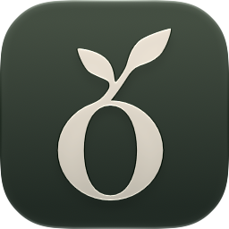
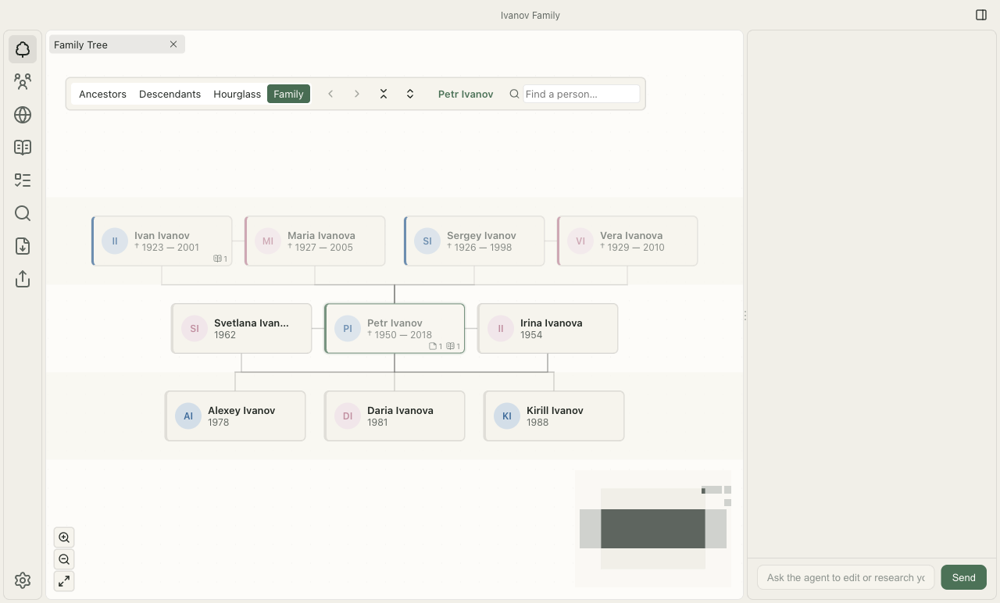

<p align="center">
  
</p>

<h1 align="center">Dóru</h1>

<p align="center"><strong>Local-first genealogy for the AI era.</strong></p>

<p align="center">
  <a href="https://github.com/borisovodov/doru/actions/workflows/ci.yml"></a>
</p>

A cross-platform desktop app for working with family trees: your data stays in
plain folders on your disk, works fully offline, and is designed to be driven
by AI agents through MCP and chat. There are no accounts, no cloud, and no
telemetry — nothing leaves your machine unless you explicitly send it
somewhere, and even AI features work with local models like Ollama if you
prefer.

Dóru is genuinely open source: the entire app is released under the
[MIT license](LICENSE.md) — free for any use, modification, and
redistribution, with no proprietary parts and no open-core tricks.

The name comes from Proto-Indo-European _\*dóru_ — “tree”.



## Highlights

- **Local-first — your data stays yours.** A project is a single `.doru`
  file (a SQLite database); photos and scans live in a `media/` folder next
  to it. Nothing is hidden; everything is editable by hand or by agents.
  There are no accounts, no cloud, no telemetry: nothing leaves your machine
  unless you explicitly send it to an AI provider you configured yourself.
- **Genuinely open source.** The whole app is MIT-licensed: free to use,
  modify, and redistribute, for any purpose. What you run is what is in the
  repo — no source-available bait, no proprietary parts.
- **AI-native.** Dóru is both an MCP server — run `doru --mcp-server <project>`
  and any MCP client (Claude Desktop, Cursor) can query and edit your tree
  through `tree_query`, `tree_edit`, `sources_add`, `notes_write`,
  `charts_render` — and an agent chat built into the UI: provider presets
  (OpenAI, Anthropic, Gemini, OpenRouter, Ollama, LM Studio, custom
  endpoints) configured in the in-app settings with keys stored in the OS
  keychain, external MCP servers, and ACP agents.
- **Auditable.** Every mutation is recorded with its actor — user or agent
  (`agent:{host}/{model}#{promptHash}`). AI edits are always reviewable and
  gated by permission prompts.
- **Workbench-style UI.** Activity bar, sidebar, tabs, editor area, panel,
  command palette, themes as text files, text-based configuration, codicons.

## Features

### Genealogy

- **Interactive tree canvas** — the tree tab is one zoomable canvas with four
  charts (ancestors, descendants, hourglass, family), focus navigation with
  history and breadcrumbs, search-to-jump, and collapsible branches. Cards
  show an avatar, years, sex and line marks, and notes/sources/media badges.
- **Editing on the canvas** — add children, spouses and parents, rename,
  delete, and drag a card onto another person to reparent; the full editor
  (names, sex, birth/death dates with a quality marker — *exact / about /
  before / after* — plus a free-text form for dates that do not map to
  Gregorian) opens as a tab. Every action is one undoable step.
- **Persons** — the People sidebar lists everyone; click a person to focus
  the canvas and open their editor.
- **Families** — add parents, partners, and children from a person editor;
  chips show the members of each family, and removing someone from a family
  is one click.
- **Sources and notes** — attach a source (title and author) as a citation or
  reuse an existing one; keep free-form research notes on any person.
- **Undo/redo** — every change, including whole GEDCOM imports and edits made
  by agents, can be undone (`Cmd+Z` / `Shift+Cmd+Z`, Ctrl on Windows/Linux).

### Import and export

- **GEDCOM 5.5 / 5.5.1 import** and **GEDCOM 7.0 export**.
- **Tabs** — a project opens in its own window, and entities (persons, the
  tree editor, settings) open as tabs inside it. Recent projects are listed on
  the start page, open project windows are restored on launch, and
  `doru://open?path=…` links or double-clicked `*.doru` files open in the
  running app.

### AI and agents

- **In-app chat** — the agent reads and edits the tree with built-in tools:
  `tree_query`, `tree_get`, `tree_stats`, `tree_edit`, `sources_add`,
  `notes_write`, `charts_render`.
- **Any provider** — presets for OpenAI, Anthropic, Gemini, OpenRouter,
  Ollama, LM Studio, and custom OpenAI-compatible endpoints; API keys are
  stored encrypted in the OS keychain.
- **Permission prompts** — read-only tools run freely; mutating tools and
  external MCP tools ask for confirmation inline.
- **MCP server mode** — run `doru --mcp-server <project>` and any MCP client
  (Claude Desktop, Cursor) can query and edit your tree; the in-app agent can
  also use tools from external MCP servers, and ACP agents are supported.

### Configuration and themes

- **`doru.json`** — plain JSON with comments, edited in any editor, picked up
  live while the app runs.
- **Themes** — the interface is styled through CSS custom properties; a dark
  and a light theme are built in and chosen per OS appearance.
- **17 languages** — the UI always follows the operating system language.

## Installation

Every link below downloads the installer for the latest release directly:

| Platform | Installer |
|---|---|
| macOS (Apple Silicon) | [doru-mac-arm64.dmg](https://github.com/borisovodov/doru/releases/latest/download/doru-mac-arm64.dmg) |
| Windows (x64) *(experimental)* | [doru-windows-x64.exe](https://github.com/borisovodov/doru/releases/latest/download/doru-windows-x64.exe) |
| Windows (arm64) *(experimental)* | [doru-windows-arm64.exe](https://github.com/borisovodov/doru/releases/latest/download/doru-windows-arm64.exe) |
| Linux (x64) *(experimental)* | [doru-linux-x86_64.AppImage](https://github.com/borisovodov/doru/releases/latest/download/doru-linux-x86_64.AppImage) or [doru-linux-amd64.deb](https://github.com/borisovodov/doru/releases/latest/download/doru-linux-amd64.deb) |
| Linux (arm64) *(experimental)* | [doru-linux-arm64.AppImage](https://github.com/borisovodov/doru/releases/latest/download/doru-linux-arm64.AppImage) or [doru-linux-arm64.deb](https://github.com/borisovodov/doru/releases/latest/download/doru-linux-arm64.deb) |

macOS is the primary platform. **Windows and Linux builds are experimental**:
they are built by CI, but have not yet been verified on real Windows/Linux
machines — expect rough edges. On Windows, SmartScreen may show a warning —
click “More info → Run anyway”. On Linux, the `.deb` installs with
`sudo apt install ./doru-*.deb`; the AppImage needs `chmod +x` and then just
runs. See the [documentation](https://doru.ovodov.me/docs/) for details.

## Documentation

See the [documentation](https://doru.ovodov.me/docs/) for installation,
tree editing, AI agents, themes, and troubleshooting.

## Development

Requirements: Node.js >= 22.13 (built-in `node:sqlite`) and npm.

```sh
npm install
npm run dev          # run the desktop app in dev mode
npm test             # unit tests (vitest)
npm run typecheck    # strict TypeScript across all workspaces
npm run build        # production build (electron-vite)
npm run e2e          # Playwright smoke test against the built app
npm run site:dev     # the VitePress website
```
