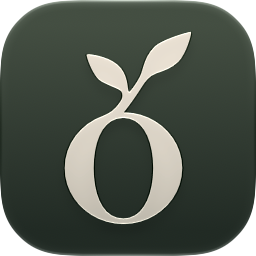
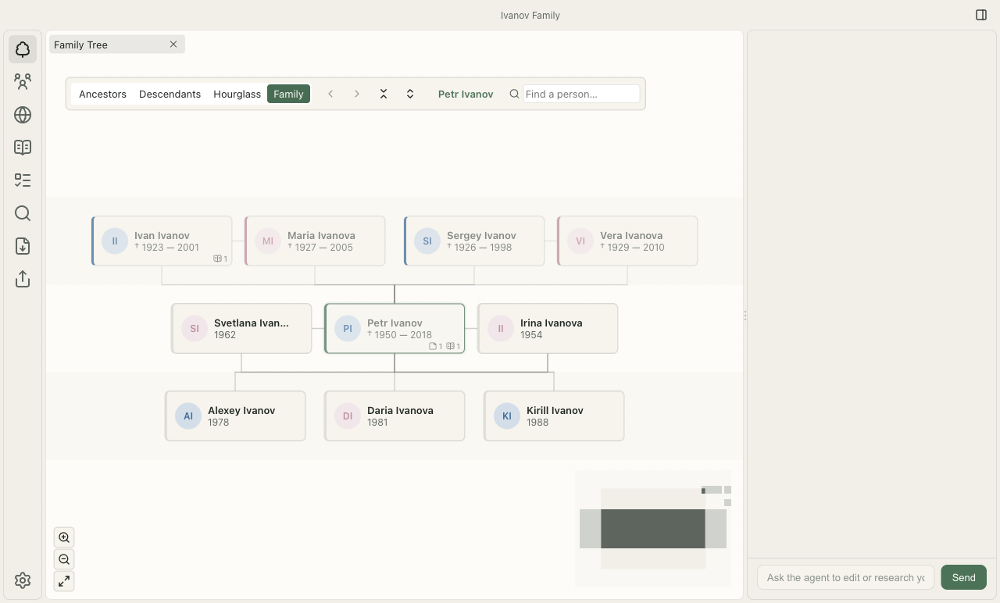

<p align="center">
  
</p>

# Dóru

**Genealogy for the AI era.**

[](https://github.com/borisovodov/doru/actions/workflows/ci.yml)

🚧🚧🚧🚧🚧🚧🚧🚧🚧🚧🚧🚧🚧🚧🚧🚧🚧🚧🚧🚧

PROJECT UNDER ACTIVE DEVELOPMENT, NOTHING WORKS, EVERYTHING CHANGES EVERY DAY UNTIL VERSION 0.1.0.

🚧🚧🚧🚧🚧🚧🚧🚧🚧🚧🚧🚧🚧🚧🚧🚧🚧🚧🚧🚧

A desktop app for your family tree. Your tree lives in a plain folder on your
disk, works fully offline, and is driven by AI agents — through the built-in
chat or any MCP/ACP client.

Dóru is genuinely open source: the entire app is released under the
[MIT license](LICENSE.md) — free for any use, modification, and
redistribution, with no proprietary parts and nothing held back.

The name comes from Proto-Indo-European _\*dóru_ — “tree”.



## Highlights

- **Local-first — your data stays yours.** A project is a single `.doru`
  file (a SQLite database); photos and scans live in a `media/` folder next
  to it. Nothing is hidden; everything is editable by hand or by agents.
  There are no accounts, no cloud, no telemetry: nothing leaves your machine
  unless you explicitly send it to an AI provider you configured yourself.
- **Genuinely open source.** The whole app is MIT-licensed: free to use,
  modify, and redistribute, for any purpose. What you run is what is in the
  repo — no source-available bait, no proprietary parts.
- **AI-native.** Dóru AI, the built-in assistant, runs entirely on your
  machine — no account, no internet. Dóru is also an MCP server — run
  `doru --mcp-server <project>` and any MCP client (Claude Desktop, Cursor)
  can query and edit your tree through `tree_query`, `tree_get`,
  `tree_stats`, `tree_edit`, `tree_add_relative`, `sources_add`,
  `notes_write` — and an agent chat built into the UI: a step-by-step wizard
  sets up the provider (Ollama and LM Studio locally, custom
  OpenAI-compatible endpoints, or ACP agents; cloud presets return one by
  one), and keys are stored in the OS keychain.
- **Workbench-style UI.** Activity bar, sidebar, tabs, editor area, panel,
  themes, and an in-app settings page.

## Features

### Genealogy

- **Interactive tree canvas** — the tree tab is one zoomable canvas with four
  charts (ancestors, descendants, hourglass, family), focus navigation with
  history and breadcrumbs, search-to-jump, and collapsible branches. Cards
  show an avatar, years, sex and line marks, and notes/sources/media badges.
- **Editing on the canvas** — add children, spouses and parents, rename,
  delete, and drag a card onto another person to reparent; the full editor
  (names, sex, birth/death dates with a quality marker — *exact / about /
  before / after* — plus a free-text form for dates that do not map to
  Gregorian) opens as a tab. Every action is one undoable step.
- **Persons** — the People sidebar lists everyone; click a person to focus
  the canvas and open their editor.
- **Families** — add parents, partners, and children from a person editor;
  chips show the members of each family, and removing someone from a family
  is one click.
- **Sources and notes** — attach a source (title and author) as a citation or
  reuse an existing one; keep free-form research notes on any person.
- **Undo/redo** — every change, including whole GEDCOM imports and edits made
  by agents, can be undone (`Cmd+Z` / `Shift+Cmd+Z`, Ctrl on Linux/Windows).

### Import and export

- **GEDCOM 5.5 / 5.5.1 import** and **GEDCOM 7.0 export** (plus `.gdz`
  archives). Hundreds of vendor tags from real-world software are recognized,
  so nothing important is lost on the way in.
- **Tabs** — a project opens in its own window, and entities (persons, the
  tree editor, settings) open as tabs inside it. Recent projects are listed on
  the start page, open project windows are restored on launch, and
  `doru://open?path=…` links or double-clicked `*.doru` files open in the
  running app.

### AI and agents

- **Built-in assistant** — Dóru AI runs entirely on your machine: downloaded
  once, no account, no internet needed. It is the default provider on a fresh
  install.
- **In-app chat** — the agent reads and edits the tree with built-in tools:
  `tree_query`, `tree_get`, `tree_stats`, `tree_edit`, `tree_add_relative`,
  `sources_add`, `notes_write`.
- **Any provider** — presets for Ollama, LM Studio, custom
  OpenAI-compatible endpoints, and ACP agents; a step-by-step wizard walks
  through the setup and fetches the model list for local providers; API keys
  are stored encrypted in the OS keychain.
- **MCP server mode** — run `doru --mcp-server <project>` and any MCP client
  (Claude Desktop, Cursor) can query and edit your tree; ACP agents are
  supported too.

### Settings and themes

- **Settings page** — providers, models, themes and more, all configured in
  the app.
- **Themes** — nine built-in themes (Dóru, One Dark, GitHub, Solarized,
  Gruvbox, Catppuccin, Ayu, Rosé Pine, Everforest), each with dark and light
  palettes that follow the OS appearance; styled entirely through CSS custom
  properties.
- **17 languages** — the UI always follows the operating system language.

## Installation

Dóru is installed through the app stores and package managers of your
platform. See the [installation guide](https://doru.family/docs/installation)
for step-by-step instructions.

## Documentation

See the [user documentation](https://doru.family/docs/) for tree editing,
AI agents, themes, and troubleshooting.

## Development

Requirements: Node.js >= 22.13 (built-in `node:sqlite`) and npm.

```sh
npm install
npm run dev          # run the desktop app in dev mode
npm test             # unit tests (vitest)
npm run typecheck    # strict TypeScript across all workspaces
npm run build        # production build (electron-vite)
npm run e2e          # Playwright smoke test against the built app
npm run ui           # Storybook for the shared UI library
npm run ui:build     # static Storybook build
npm run site:dev     # the VitePress website
```

### Storybook

`npm run ui` starts the component gallery at
[http://localhost:6006](http://localhost:6006). Stories live next to their
components in `packages/ui/src`: atoms, patterns, and domain components. Every
shared component should have a story that shows its relevant sizes, variants,
and states.

The Storybook toolbar switches between bundled themes, dark/light mode, and
all 17 UI locales. To preview themes from a running app profile as well, point
`DORU_USER_DATA` at that profile:

```sh
DORU_USER_DATA="<app user-data directory>" npm run ui
```

`npm run ui:build` produces the static gallery in
`packages/ui/storybook-static`; CI runs it to catch broken stories.
