# Database schema

A Dóru project is a single `.doru` file: a SQLite database branded with
`application_id = 0x444F5255` ("DORU") and versioned with `user_version`.
This document is the field-level reference for **schema version 27**. The
source of truth is [`packages/core/src/db/schema.ts`](../packages/core/src/db/schema.ts);
the domain shapes that the repositories map onto the rows live in
[`packages/core/src/model/types.ts`](../packages/core/src/model/types.ts).

The schema is deliberately Dóru's own domain model, not a mirror of the GEDCOM
wire format. GEDCOM HEAD/SUBN metadata and raw vendor records are not stored;
they are counted as dropped on import, and export synthesizes a fresh header.
Round-trip fidelity is not an application requirement: the schema stores what
Dóru models, and import/export maps that subset. `@doru/gedcom` keeps the wire
model faithful for the structures it models, except for the drops documented
in its README; that guarantee does not extend to the tree database.

## At a glance

- **43 tables**, **69 indexes**, and no date-delete triggers.
- The core genealogy model is `person` → `person_name` / `fact`, with
  `family` joining people through `family_partner` and `family_child`.
- Dates are normalized into one `date` value table; owner rows reference
  their date slots through explicit `*_date_id` foreign keys.
- Task times are epoch-millisecond integers (`created_at`, `updated_at`,
  `remind_at`), not `date` rows.
- Top-level records carry Dóru-local `created_at`/`updated_at` epoch-millisecond
  instants; child, link and value rows do not.
- Notes, citations, media, contacts, contributors, and tasks
  attach through a polymorphic `(target_type, target_id)` pair.
- Files are not stored in SQLite. A `media` row holds one project-relative
  path or an external URL; the bytes live in the `media/` folder next to the
  `.doru` file, or remain an external reference.

### Diagram legend

- `PK` — primary key.
- `FK` — foreign key.
- `UK` — unique key. Composite uniqueness is described in the field comment
  or in the prose around the diagram.
- Empty "stub" entities (for example `person` in the family diagram) show
  only the referenced key; the full table appears in its own diagram.
- SQLite storage classes are used as types (`TEXT`, `INTEGER`, `REAL`).
  Domain-level enums are still `TEXT` so unknown future values do not make a
  file unreadable.
- Polymorphic targets (`target_type` + `target_id`) cannot be drawn as
  ordinary foreign-key lines; they are called out in the text. Date slots are
  ordinary forward foreign keys and appear as normal `FK` columns.

## Conventions

- Every addressable row has a **UUID primary key** generated by the
  application. The two exceptions are rows whose identity is the pair itself:
  `fact_flag` and `submitter_language`.
- GEDCOM xrefs are not stored. Import uses them transiently to resolve
  pointers, and export generates fresh `@…@` identifiers for every record.
- `position` preserves user-visible order in names, name parts, family
  partners/children, marriage statuses, family witnesses, place names,
  source and citation template fields, event-family links, additional places,
  participants, and address lines.
- Boolean-like columns are `INTEGER` with `0`/`1`; flags are stored in
  lowercase where they have a textual form.
- Enum-like columns have no `CHECK` constraint. The only structural checks are
  the "exactly one owner" checks on `fact` and `association`.
- `target_type` values come from the per-family sets in
  `packages/core/src/model/targetPolicy.ts`. Date slots are plain `*_date_id`
  columns on the owner table; the role is the column name.

## Record timestamps

`person`, `family`, `place`, `source`, `media`, `repository`, `submitter`,
`address`, `title`, `note` and `task` carry two Dóru-local epoch-millisecond
instants. They are operational provenance, not genealogical dates and not a
change log. Child rows, link rows and `date` values have no timestamps of
their own.

`created_at` is the first write of the row: the application clock for a record
created in Dóru, the import instant for an unparseable GEDCOM stamp. `updated_at`
is the last edit of the aggregate's own content. Editing names, facts,
partner/child links, files, place names or address lines moves the root's
instant; adding or removing notes, citations, media links, task links,
contacts or contributors does not. Deleting a place, address,
title or repository and detaching dangling references does not move the
consumer's instant either. A fact's own `CHAN` moves the owning person or
family, because facts are part of that aggregate and have no separate stamp.

GEDCOM import maps structured `CREA`/`CHAN` and the vendor
`_CREAT`/`_CREA`/`_CRE`/`_UPD` spellings when they contain a complete exact
date. Typed record fields win; the same tags left in generic extensions are
the second priority. `CREA` and vendor creation text fill `created_at`;
`CHAN`, `_UPD` and the latest fact `CHAN` fill `updated_at`. When a record has
no creation stamp, the earliest known change date is used as its lower bound.
Partial, approximate, range, BCE and unparseable values are dropped rather
than invented. When no GEDCOM stamp is usable, both instants are the single
import instant. Export does not synthesize `CHAN` or `CREA`.

---

## Persons, names, and aliases

A person row is intentionally thin: names, facts, addresses, aliases, and
associations are separate rows. A person may have several names; each name
may have several ordered parts and any number of nested translation,
phonetic, or romanized variants.

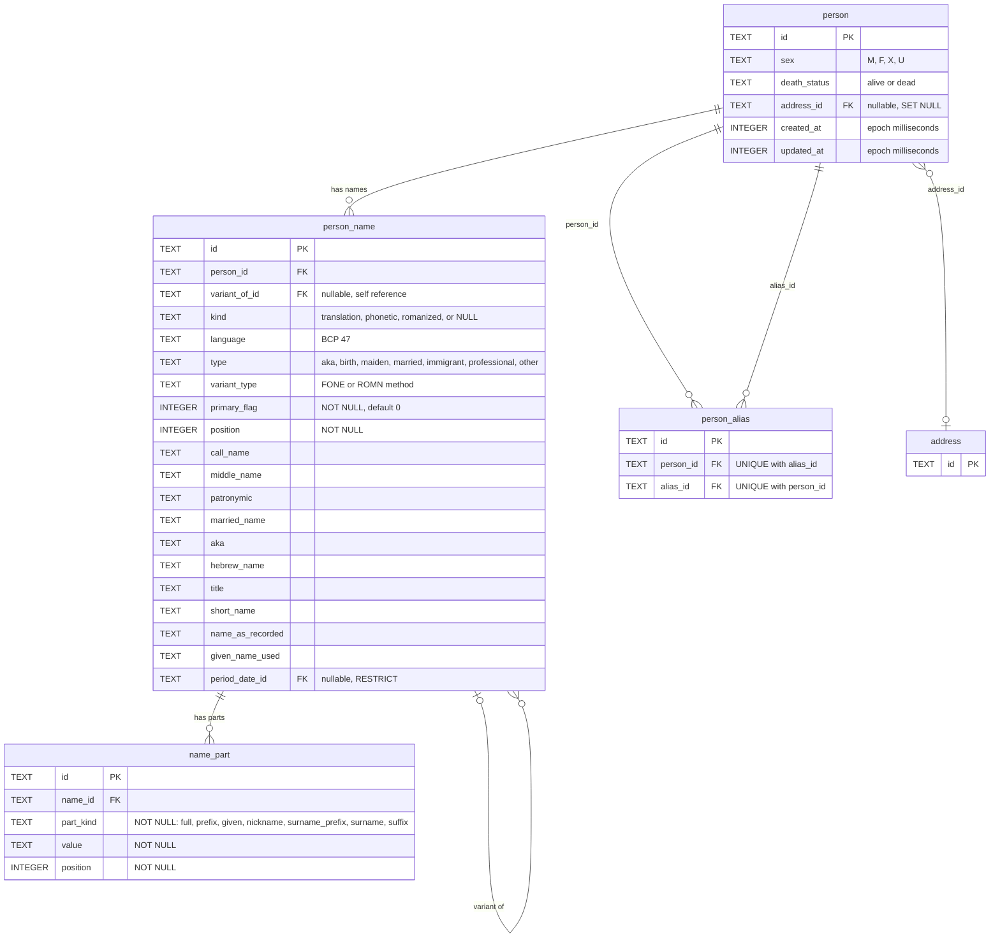

The flat name fields exposed by the model (`given`, `surname`, `prefix`, …)
are projections of the first part of each kind; the stored source of truth is
`name_part`. `person_alias` links two person rows and is not a merge: both
people keep their own facts and attachments.

## Families

A family is a union record. Partners and children are link rows with their
own UUIDs, ordering, and link-level metadata, so an attachment can target the
specific "partner in this family" or "child in this family" slot.

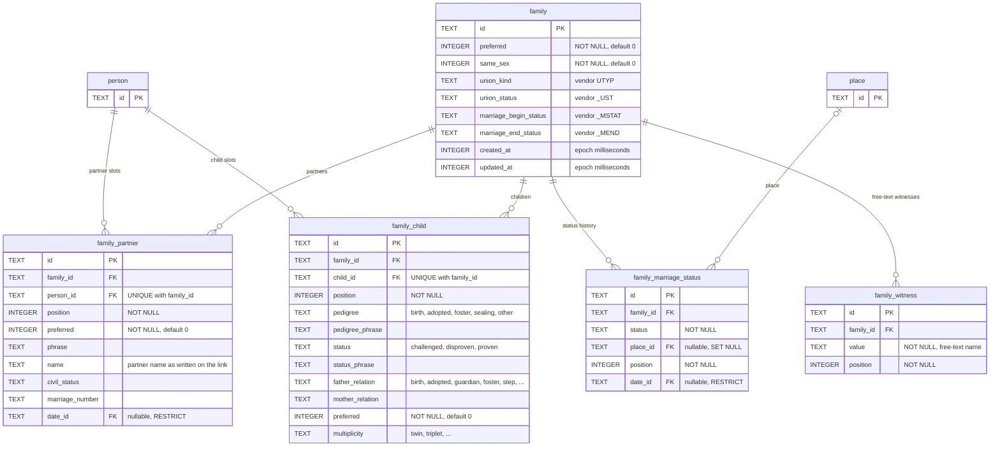

`family_witness` is deliberately not an attachment target: it is a name
written into the record, not a person with stable identity. Use `association`
when a witness needs notes, sources, or tasks.

## Facts and events

A fact is an event or an attribute. It belongs to exactly one owner — a person
or a family — enforced by a `CHECK`. Event-level extras (ages, participants,
flags, additional places, and the families an event refers to) are separate
rows.

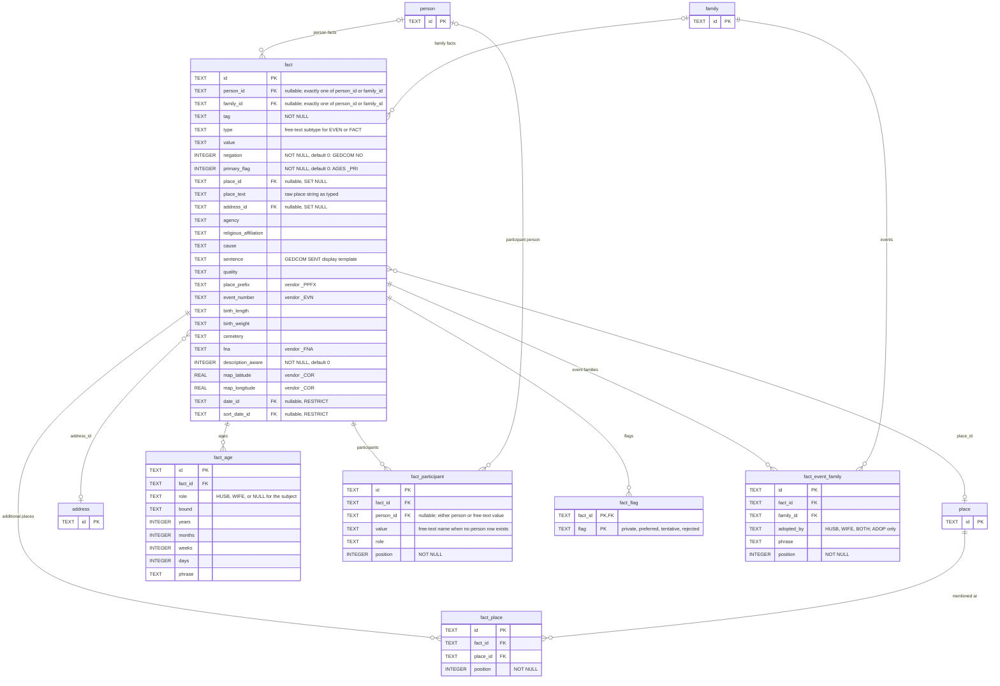

Fact dates live in the `date` table through the forward foreign keys
`fact.date_id` and `fact.sort_date_id`. A period is one `range` value. The
import layer folds the vendor `_DATE2` second date into that range's end;
export writes a single standard `DATE`. Fact lists sort by `sort_date_id`
when it contains a usable date, otherwise by `date_id`; the comparison uses
year, month, day and time, with `BEF` before and `AFT` after the component
and unknown dates last. See [Dates](#dates).

## Associations

A GEDCOM `ASSO` is either a person association or a family association. The
other side is always a person. The row can carry a role, a relationship, a
free-text phrase, a confidence, and a period.

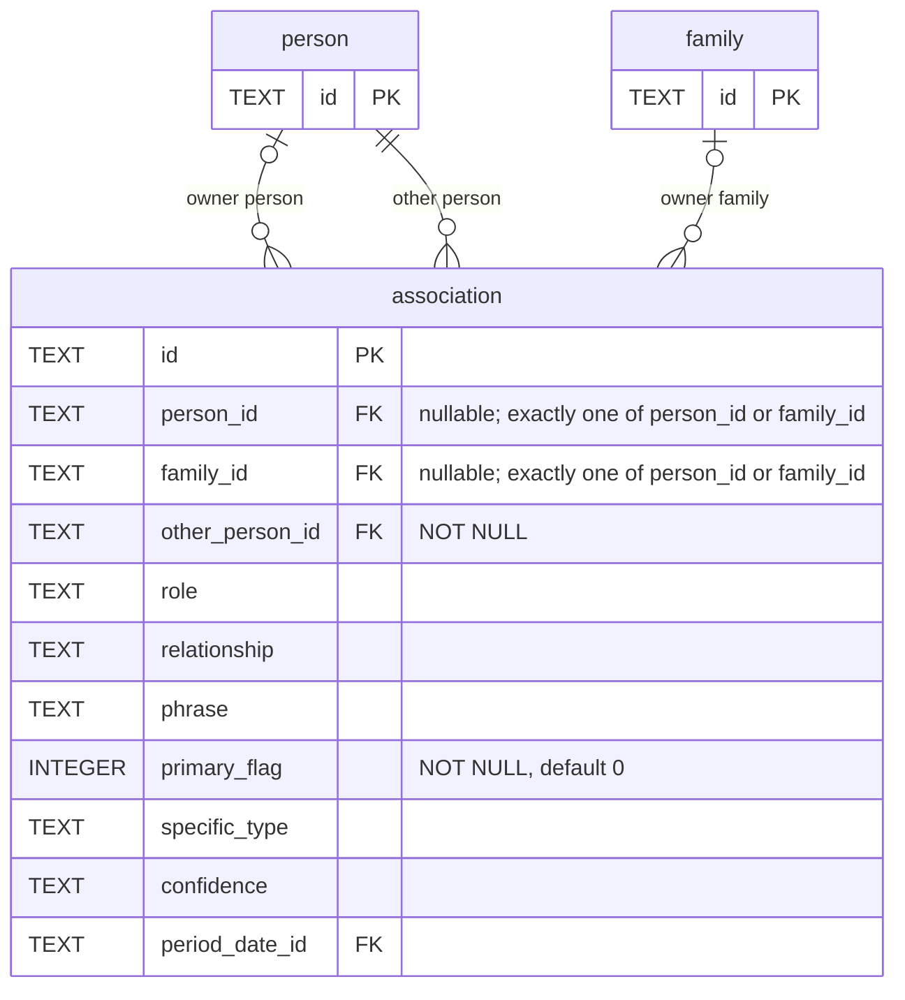

`association.period_date_id` stores the whole period as one `range` value. The
import layer folds `_PERIOD/_START` and `_PERIOD/_END` into that range; export
splits the range back into the two extension slots.

## Dates

`date` is a value table: each row holds one complete date value and has no
owner or role columns. Owner rows reference their slots through forward
foreign keys with `ON DELETE RESTRICT`.

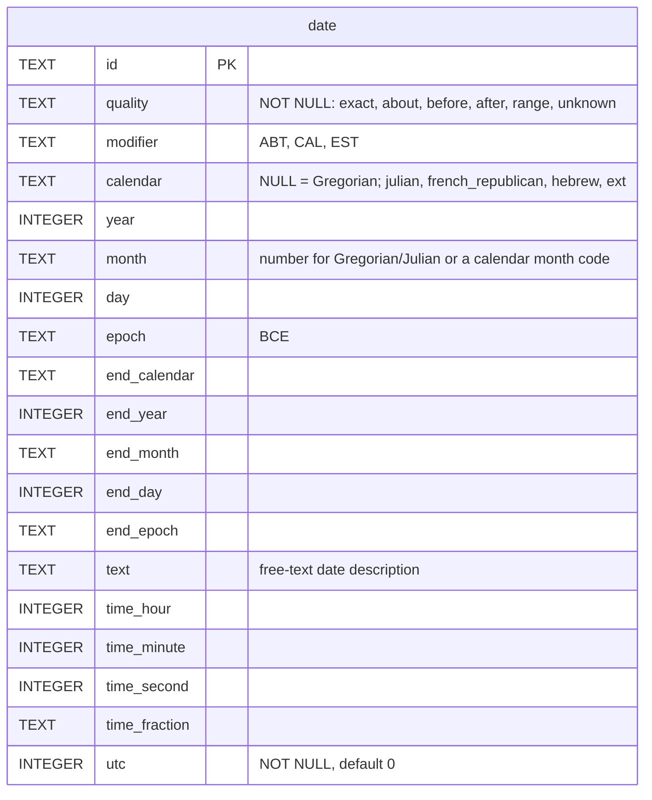

The role of a date is the name of the column that references it:

| Owner table | Date columns |
|---|---|
| `person_name` | `period_date_id` |
| `family_partner` | `date_id` |
| `family_marriage_status` | `date_id` |
| `fact` | `date_id`, `sort_date_id` |
| `place_name` | `date_id` |
| `place_hierarchy` | `date_id` |
| `place_postal_code` | `date_id` |
| `source` | `publication_date_id` |
| `source_data_event` | `date_id` |
| `citation` | `date_id` |
| `media` | `date_id` |
| `association` | `period_date_id` |

A column is nullable and each slot holds at most one date. The foreign keys
use `ON DELETE RESTRICT`: deleting a date row that is still referenced by any
owner fails loudly.

There are no `AFTER DELETE` triggers. Repositories create the date rows before
the owner row and release them explicitly:

- Insert: create the date rows, then insert the owner row with their ids.
- Update: `DateRepo.prepareSlots` writes the surviving dates, keeps the id of
  every occupied slot, returns the ids for the owner update, and reports the
  old ids to delete after the owner row no longer references them. Aggregate
  updates reserve the ids owned by the old rows for the whole operation, so a
  date copied into another slot gets a fresh id even when its source row was
  deleted earlier in the same update.
- Delete: collect the date ids of the owner and every cascaded child — for a
  source, its data events and citations; for a place, its names, hierarchy
  rows on either side, and postal codes — delete the owner row, then delete
  all collected date rows.

A date row has exactly one owner by application convention. The schema cannot
express "unique across twelve tables"; repositories never share a date, and
a copy gets a fresh id. Tests check that no date is orphaned, and
`ON DELETE RESTRICT` catches a leaked share during deletion. Any new
date-owning table must add its `*_date_id` columns, indexes, and delete
cleanup in the repository.

## Places

A place is a first-class entity with hierarchical names. `place_name` rows
are jurisdiction levels (smallest first); `place_hierarchy` is a graph rather
than a strict tree, because the same place can belong to several hierarchies
with different types.

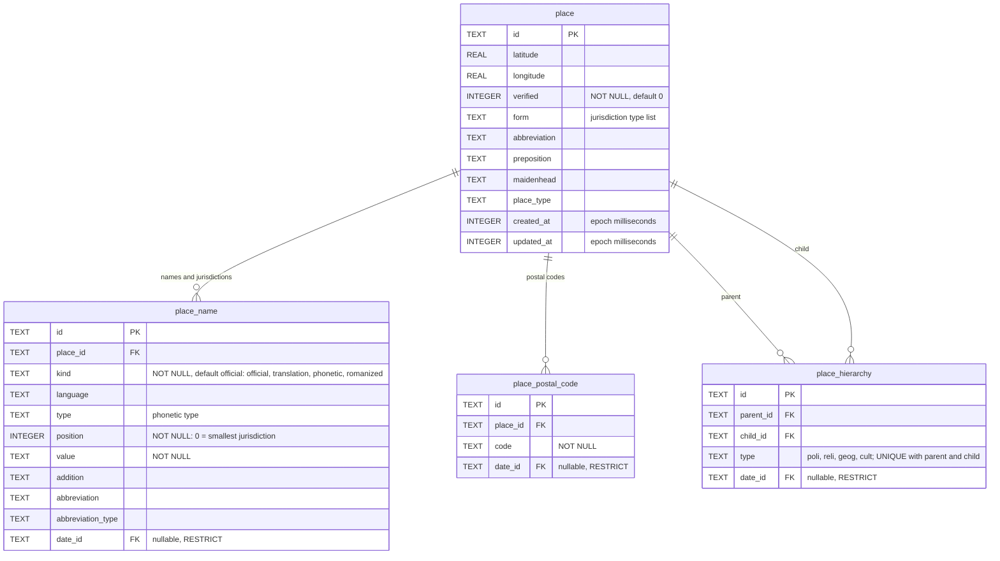

## Sources and bibliography

A `source` is a concrete record; a `title` is the bibliographic work behind
it; a `repository` is the archive or institution that holds it.
`source_repository` is the many-to-many link, and `call_number` belongs to
that link rather than directly to either side.

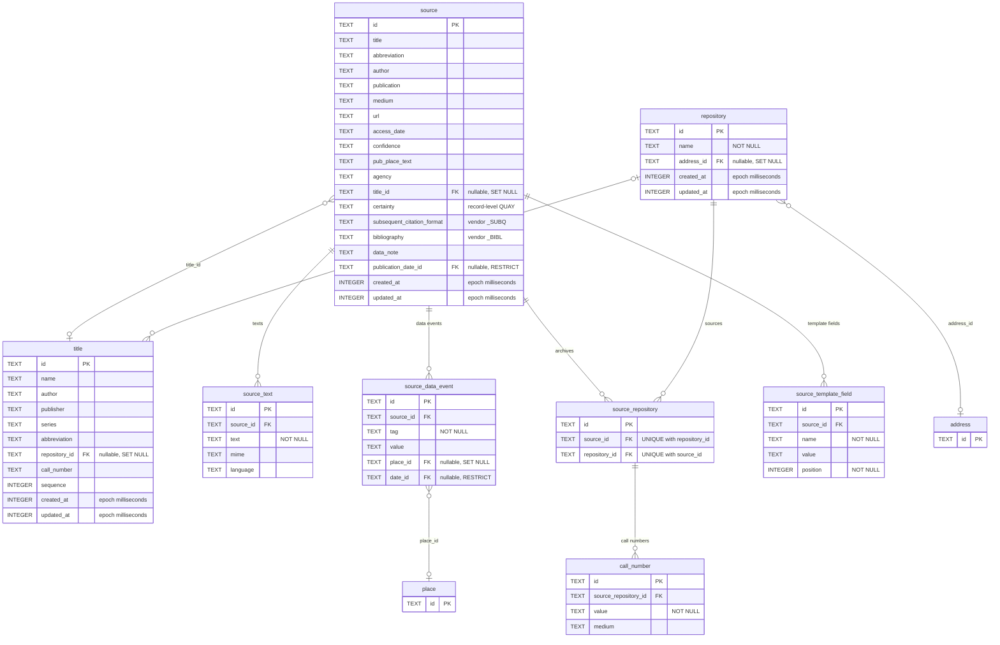

`source.publication_date_id` and `source_data_event.date_id` point into the
`date` table (`publication` and `date` roles respectively); the date value
itself is not duplicated here.

## Citations

A citation is a source cited at a specific target. It always belongs to one
source; the target is polymorphic. Citation-level texts and template fields
are child rows, and a citation has its own date row.

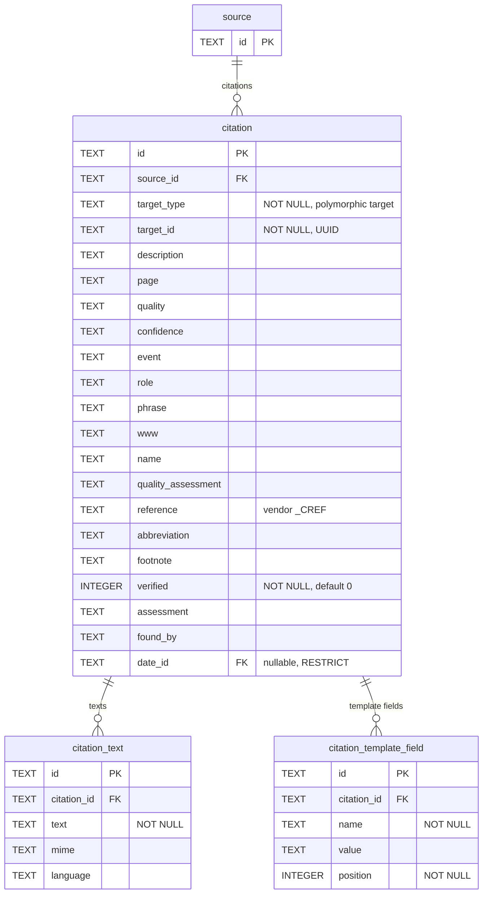

Deleting a source cascades to its citations. Citation targets are cleaned by
the op layer, not by SQLite foreign keys.

## Media

A media record is a one-file metadata container. File bytes live outside
SQLite; the `path` is either a project-relative path under `media/` or an
external URL. New media is accepted only as JPEG or AVIF and stored as an
AVIF copy, so a new row's local path always ends in `.avif`; existing projects
may still contain older displayable formats. New file names are the first 32
hex characters of the SHA-256 of the stored AVIF: identical bytes share one
file, and several media rows may reference the same path.
Each media record may be linked to several targets. A GEDCOM `OBJE` with
several `FILE` rows is split into one media record per file on import; `TRAN`
is not stored.

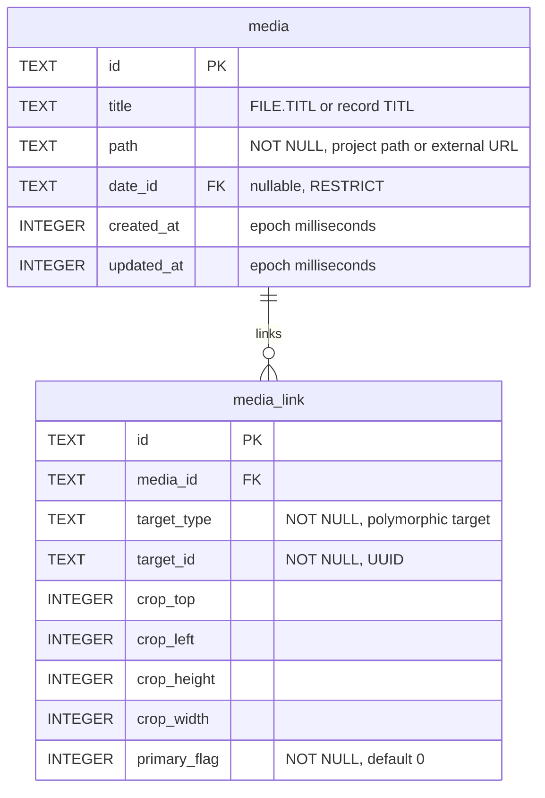

A media record stores only its title, path and historical date. Other GEDCOM
metadata (`_PLAC`, `_TYPE`, `_DSCR`, `_KEYS`, `MEDI`, `_CTYP`, `_TEXT`) and
file facts (MIME, size, dimensions) are not persisted: `@doru/gedcom` parses
them, and the core mapping drops them. A media link stores the crop and the
primary flag. It is not an attachment target: notes, citations, media,
contacts, contributors and tasks may not point at it. Media-level notes,
citations, tasks and contributors target `media` directly; there is no
separate file target.

## Notes

A note is one text row with creation and last-update instants (epoch
milliseconds) and exactly one owning target. The polymorphic
`(target_type, target_id)` pair lives on the note row itself; there is no
separate note-link table. A note is never an attachment target: citations,
media links, contacts, contributors, tasks and other notes cannot point at
it. GEDCOM shared notes are copied per target on import, and
export writes every note as an inline `NOTE`. `NOTE.SOUR`/`SNOTE.SOUR` is
parsed by `@doru/gedcom` but dropped on import and not written on export.

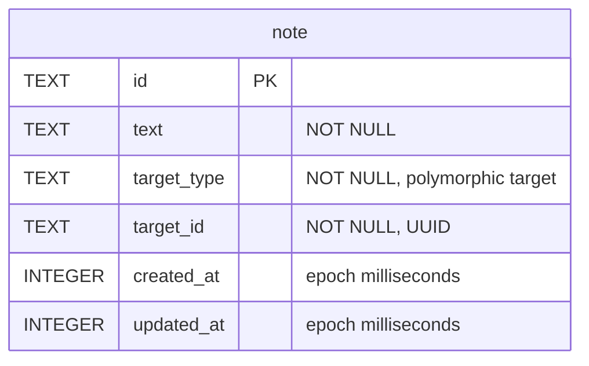

## Addresses and submitters

An address is shared: `person`, `repository`, and `submitter` all point at the
same address row through `address_id`. Address lines are separate ordered
rows. A submitter is a contributor record with languages and links to any
attachable target.

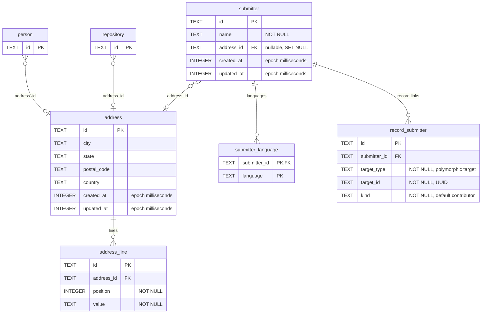

`record_submitter.kind` is `contributor`, `ancestor_interest`, or
`descendant_interest`. The target is any type in
`RECORD_SUBMITTER_TARGET_TYPES`; `task`, `media_link`, and `submitter` are
absent, so a contributor link cannot point at a task, a media link, or another
submitter. `family_partner` and `family_child` link rows remain valid
contributor targets.

## Attachments and research

These tables are the cross-cutting layer. Most of them use the polymorphic
`(target_type, target_id)` shape; dates are ordinary forward foreign keys
from the owner table.

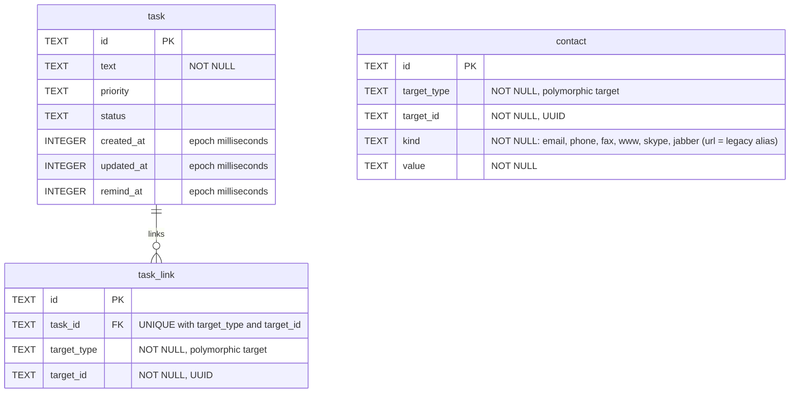

`task` is a shared entity: it can be free-standing or linked to any number of
targets through `task_link`. Deleting a target removes its link rows but keeps
the task (and its own attachments) alive, so a task shared by a person and a
place survives removing either one. GEDCOM import and export still map the
record to the `_TODO` record/structure in `@doru/gedcom`, but the Dóru table,
model type, tab prefix, and UI strings all use the task vocabulary
(`TaskRecord`, `TaskTab`, the `task:` tab prefix, `features.tasks.*`).

Task times are **epoch milliseconds**, not genealogical dates: `created_at`
is set once by the application (or mapped from a complete exact GEDCOM task
date on import), `updated_at` changes on every task edit (or is mapped from a
complete exact `CHAN`), and `remind_at` is the single user-chosen reminder
instant. Closing a task only changes its status; the schema has no completion
timestamp. Import accepts complete exact dates only (including My Family
Tree's encoded `DDMMYYYY` record slots); partial, approximate, range, or
otherwise unparseable values are not used as task dates. Without a usable
creation date, `created_at` is the import instant; a usable `CHAN` sets
`updated_at` but never moves it before `created_at`.

The GEDCOM `TODO` `REPO` slot is parsed by `@doru/gedcom` and imported as a
repository target (`task_link`), not as a direct column. The `_CAT`, `_LOCL`,
`_TTIL`, `TYPE`, and `DATA` slots are still parsed but deliberately ignored on
import and not written on export. Dóru stores no direct task-to-repository
column, task category, task locality, task title, task type, or task-result
text.

`REPO` is not written on export. Because a repository has no GEDCOM slot for an
embedded `_TODO` structure, a task whose only target is a repository is dropped
from the exported file; tasks linked to a person or family are still written
under those records. Task statuses use the canonical `open`, `waiting`,
`in-progress`, and `closed` values. GEDCOM spellings are normalized on import
(`Open` → open, `Completed` → closed,
`INPROGRESS`/`InProgress` → in-progress); empty, missing, and unknown statuses
become `open` immediately. Priorities use `low`, `medium`, and `high`; empty,
missing, and unknown values become `medium`, and numeric 1–9 priorities are
mapped with 1 as the highest.

---

## Polymorphic targets

The following tables use `(target_type, target_id)` without a foreign key. Each
link family has its own explicit set in
`packages/core/src/model/targetPolicy.ts`; the service guards, attachment
panel sections, `canAdd` flags, and target pickers all read those sets. There
is no global runtime target list.

| Table | Policy set | Allowed targets |
|---|---|---|
| `note` | `NOTE_TARGET_TYPES` | person, family, family_partner, family_child, family_marriage_status, fact, name, name_part, source, citation, media, place, place_name, place_hierarchy, repository, submitter, address, address_line, association, task, title |
| `citation` | `CITATION_TARGET_TYPES` | person, family, family_partner, family_child, family_marriage_status, fact, name, name_part, source, media, place, place_name, place_hierarchy, repository, submitter, address, address_line, association, title |
| `media_link` | `MEDIA_LINK_TARGET_TYPES` | person, family, family_partner, family_child, family_marriage_status, fact, name, name_part, source, citation, place, place_name, place_hierarchy, repository, submitter, address, address_line, association, task, title |
| `contact` | `CONTACT_TARGET_TYPES` | person, fact, repository, submitter |
| `task_link` | `TASK_LINK_TARGET_TYPES` | person, family, family_partner, family_child, family_marriage_status, fact, name, name_part, source, citation, media, place, place_name, place_hierarchy, repository, address, address_line, association, title |
| `record_submitter` | `RECORD_SUBMITTER_TARGET_TYPES` | person, family, family_partner, family_child, family_marriage_status, fact, name, name_part, source, citation, media, place, place_name, place_hierarchy, repository, address, address_line, association, title |

`name` refers to the `person_name` table. `family_witness` is deliberately
absent from every set: it is free text without stable identity. A note record
is not itself a target type: it is a leaf annotation and no attachment may
point at a note.

`task_link` stores one task's links to any number of targets. A task may point
at a source (for example, "check this source"), the records the work concerns,
and media, but not at another `task`, a `submitter`, or a `media_link`.
Task-to-task chains duplicate the research log, and a task is not a citation of
a submitter's contribution or of a link row. Notes and media may still target
a task, but contributors and citations may not. A task without a
person or family target has no GEDCOM embedding slot and is dropped on export.

A `citation` never targets a task: a source is evidence for a genealogical
assertion, while a task is a work item that asserts nothing. A citation also
never targets another citation or a media link. The task tab therefore has no
sources section, and `TreeService` rejects a citation whose target type is
`task`, `citation`, or `media_link`.

A `contact` row exists only on a target GEDCOM can carry contact details for:
`person`, `fact`, `repository`, or `submitter`. Event details and the
`REPO`/`SUBM` records carry `PHON`/`EMAIL`/`FAX`/`WWW` in 7.0; 5.5.x keeps
them inside the address block, so the importer hoists those rows onto the
address owner and the 5.5.1 serializer merges them back into the address.
Direct `INDI` contact spellings are a vendor extension Dóru keeps on a person.
`kind` stays open (`email`, `phone`, `fax`, `www`, `skype`, `jabber`, an
unknown value, or the legacy `url` alias for `www`), and the same kinds are
offered on every supported target. `skype` and `jabber` are project-only on
`person`, `fact` and `repository`: only `submitter` rows have a GEDCOM output
path (`_SKYPEID`/`_JABBERID`). `TreeService` rejects a contact on any other
target; the table itself remains polymorphic and cannot enforce the rule with
a foreign key.

`media_link` is not an attachment target: it carries only the crop and the
primary flag for one media record at one target. It cannot own notes, media,
contacts, contributors, citations, or tasks, and a task cannot target it. A
media link may still target a task as a media attachment.

Because there is no SQL foreign key, the target-policy sets plus the op layer
are the integrity boundary. Every op that deletes or detaches a target must
clean its attachment rows, and the inverse op restores the captured attachment
snapshot.

## Foreign keys and deletion behavior

Most child rows are removed with their parent:

- `person` → names, name parts, family partner/child links, facts,
  fact participants, aliases, associations.
- `family` → partner/child links, marriage statuses, witnesses, facts,
  event-family links, associations.
- `source` → source texts, data events, source repositories, template fields,
  citations.
- `citation` → citation texts and template fields.
- `media` → media links.
- `note` → none (a note is a leaf annotation).
- Every target → its notes (notes are owned by one target).
- `address` → address lines.
- `submitter` → languages and record-submitter links.
- `task` → task links (the task itself survives a target deletion).
- `fact` → ages, participants, flags, event-family links, additional places.

References that are cleared instead of deleting the child use `SET NULL`:

- `person.address_id`, `repository.address_id`, `submitter.address_id`
- `fact.place_id`, `fact.address_id`
- `family_marriage_status.place_id`
- `source_data_event.place_id`
- `source.title_id`, `title.repository_id`

`date` rows are referenced by owner rows through forward foreign keys and
are not cleaned up by triggers. The repositories create dates before the
owner row and delete them after the owner row is gone; `ON DELETE RESTRICT`
rejects deleting a date that is still referenced. Any new date-owning table
must add a `*_date_id` column and date cleanup to its repository.

## Indexes

The schema has 69 regular indexes:

- Parent/child lookups are indexed on the child columns: `person_name`,
  `name_part`, `family_partner`, `family_child`, `fact_*`, `place_*`,
  `source_*`, `citation_*`, `media_*`, `address_line`,
  `submitter_language`, `record_submitter`, and the rest.
- Ordered child lists use `(parent_id, position)`.
- Polymorphic attachment tables use `(target_type, target_id)`.
- Every date slot has its own index (`person_name.period_date_id`,
  `fact.date_id`, `association.period_date_id`, …) so the `RESTRICT` check
  does not scan owner tables.
- `task.remind_at` is indexed for reminder lists and ordering;
  `task_link.target_type/target_id` is indexed for target lookups.
- No search index or FTS table exists yet. Person search is an in-memory
  substring scan over the stored name parts.

## UI mapping

The workbench opens dedicated entity tabs for ten roots. Everything else is
edited inside a parent card or through an attachment section.

| Tab prefix | Main tables |
|---|---|
| `person:` | `person`, `person_name`, `name_part`, `fact` + fact children, `association`, `person_alias`, attachments |
| `family:` | `family`, `family_partner`, `family_child`, `family_marriage_status`, `family_witness`, `fact` |
| `source:` | `source`, `source_text`, `source_data_event`, `source_repository`, `call_number`, `source_template_field`, `citation` |
| `place:` | `place`, `place_name`, `place_hierarchy`, `place_postal_code` |
| `repository:` | `repository`, `address`, `source_repository`, `title` |
| `submitter:` | `submitter`, `submitter_language`, `record_submitter` |
| `address:` | `address`, `address_line` |
| `task:` | `task`, `task_link` |
| `media:` | `media`, `media_link` |
| `title:` | `title` |

The compact list card is `EntityCard`; the shared editor header is
`EntityViewCard`; the canvas has its own `PersonCardView`. `Note`,
`citation`, `association`, `fact`, `date`, person/place name rows,
family link rows, source child rows, media links, contacts,
and contributor links do not have their own tabs.

## Schema evolution

There are no migrations before 1.0.0. A build refuses to open a `.doru` file
whose `user_version` differs from its `SCHEMA_VERSION`; the error is loud
rather than a half-understood upgrade. Existing test projects must be
recreated or re-imported after a schema bump.

Keep a copy of the original file and the build that wrote it before opening
it with a newer schema. Re-importing does not preserve data the current
schema does not model, including tags and other unsupported vendor records;
older builds cannot read files written by newer ones.

When adding a table or column, keep the following checklist:

1. Bump `SCHEMA_VERSION` in `packages/core/src/db/schema.ts`.
2. Give the row a UUID primary key unless its identity is inherently a
   composite pair.
3. Add `position` when the rows are user-ordered.
4. Use `ON DELETE CASCADE` for owned child rows and `SET NULL` for optional
   shared references.
5. If the new row can receive notes, sources, media, contacts,
   contributors, or tasks, add its type to the relevant sets in
   `packages/core/src/model/targetPolicy.ts`, render the matching panel
   section, and wire the op cleanup.
6. If the new row can own dates, add its `*_date_id` columns (with
   `ON DELETE RESTRICT`), indexes, and repository delete cleanup.
7. Add indexes for every foreign-key child column and for ordered lists.
8. Keep enum-like columns as plain `TEXT`; do not add a `CHECK` that would
   reject a future value.
9. Add repository/op tests for create, delete, attachment snapshot, and undo.

## Known gaps

- There is no `fact_type` dictionary table. `fact.tag` and `fact.type` are
  free text; user-defined fact types exist only as values in those columns.
- There is no HEAD/header table. GEDCOM metadata is not persisted.
- There is no search index or FTS table; search is in memory.
- `family_witness` is intentionally not an attachment target.
- UI presentation (colors, card layout, ordering in the sidebar) is not part
  of the database schema.
